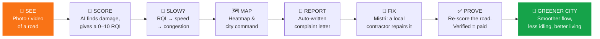

<div align="center">

# 🛣️ SadakSense

### Fix the road. Free the traffic. Clear the air.

**An end-to-end pipeline that turns a single pothole photo into a greener, faster, better-run city.**

[](https://sadaksense.netlify.app)
[](#-why-this-exists)

**👉 [Try it now: sadaksense.netlify.app](https://sadaksense.netlify.app) 👈**

> ⭐ **Short on time? Open [`guide.html`](./guide.html) first.** It's the map of the entire project: every page, one click away, plus a 4-stop demo route that shows the whole idea in about 3 minutes.

</div>

---

## 🤔 Quick question

**What do a pothole, a traffic jam and a polluted street have in common?**

They're the same problem at three different zoom levels.

A pothole makes drivers brake, swerve and crawl. One crawling car becomes a queue. A queue becomes a jam. A jam means thousands of engines idling, burning fuel and filling the air we breathe. And the pothole usually stays there for months, because nobody can prove how bad it is, who should fix it, or whether it was ever really fixed.

**SadakSense (सड़क = "road") closes that whole loop.**

---

## 💡 What is SadakSense?

SadakSense is a **road-to-greener-city pipeline**. It takes one humble input, a photo or video of a road, and carries it through every step a city needs to actually get it fixed:



> **One sentence:** *SadakSense finds the damage, scores every road, shows where it's slowing the city down, gets it reported, gets it fixed, and **proves** it was fixed.*

---

## 🌍 Why this exists

Built for the hackathon theme **07 · Greener Cities, Better Living**: *"Cities are growing, but so are pollution, traffic, and everyday challenges. How can we make them better places to live?"*

| Theme goal | How SadakSense answers it |
|---|---|
| 🚗 **Making daily travel more sustainable and convenient** | Bad roads are the hidden cause of slow, stop-start travel. We find them, rank them and get them fixed. |
| 🚌 **Improving public transport and shared mobility** | Buses, autos and shared rides all lose time on broken stretches. A road-quality map shows planners exactly where. |
| 🌫️ **Understanding and reducing pollution** | Smoother roads mean steadier traffic flow, so less braking, less idling and less wasted fuel. |
| 🏘️ **Helping communities identify and solve local problems** | Anyone can scan a road, generate a formal complaint, and track a repair through to verification. |

---

## 🧭 The pages, and why each one exists

> 🔑 **Highly recommended:** start at **[`guide.html`](./guide.html)**. It links to every page below, tells you what to click, and offers a guided demo route.

| # | Page | File | The job it does |
|---|------|------|-----------------|
| 🏠 | **Landing** | [`landing.html`](./landing.html) | **The story.** One scroll explaining the problem, the method and the result. Start here if you want the *why*. |
| 🧭 | **Guide** | [`guide.html`](./guide.html) | **The map.** Every page in one view, a "pick your goal" helper and a 4-stop demo route. **Read this first.** |
| 🔍 | **Analyzer** | [`main.html`](./main.html) | **The engine room.** Upload a road photo or video and get detected damage, a **Road Quality Index (RQI)**, estimated speed, congestion level, risk factors and a ready-to-send complaint. |
| 🏙️ | **City Command** | [`city.html`](./city.html) | **The planner's cockpit.** A 3D road-health twin of New Delhi (Connaught Place to India Gate). See which roads are in poor shape, **predict which will fail** over 1 week, 1 month or 3 months, run what-ifs (rain, rush hour, heavy trucks, a road closure) and let the system pick the repairs that protect the most roads for a budget. |
| 🌡️ | **Heatmap** ("Network Pulse") | [`heatmap.html`](./heatmap.html) | **The big picture.** A map coloured by road quality: critical, moderate, good, unscanned. Click any stretch for its score, speed, potholes, 7-day trend and alerts. |
| 🎮 | **3D Visualizer** ("Inspector Run") | [`game.html`](./game.html) | **Feel it, don't just read it.** A 90-second driving game on one road with three lanes: severe, moderate and smooth. Rough lanes pay more but wreck your suspension. It shows *why* road quality changes speed, safety and traffic. |
| 🧱 | **3D Rebuild** | [`spatial.html`](./spatial.html) | **Street to 3D.** Reconstruct a street scene (Connaught Place) from imagery into a 3D mesh and walk through it with road quality and time-of-day toggles. |
| 🧰 | **Mistri** | [`mistri.html`](./mistri.html) | **Close the loop.** Turns the worst stretches into repair jobs for small local contractors. After the repair, the road is **scored again**; if it improves enough, the fix is **verified** and (in the demo, simulated) payment is released. |
| ⚡ | **Boot screen** | [`app.html`](./app.html) | A short system-initialisation sequence that routes into the dashboard. |

### 🛤️ The 3-minute demo route (from `guide.html`)

1. **Analyze a road** → upload a photo or pick a sample in the Analyzer. Watch damage get found and scored.
2. **See the city** → City Command. Zoom out from one pothole to a whole network.
3. **Read the heatmap** → every stretch coloured by quality. Click one.
4. **Send a mistri** → turn a bad stretch into a repair job, then watch the fix get verified by a new score.

---

## 🧪 How it works under the hood

### 1. Road Quality Index (RQI): a number everyone can understand
Every road gets a score from **0 to 10**:

| RQI | Condition |
|-----|-----------|
| **7.0 – 10** | 🟢 Optimal (Smooth) |
| **3.5 – 7.0** | 🟡 Moderately Damaged |
| **0 – 3.5** | 🔴 Heavily Damaged (critical) |

The baseline is a **transparent weighted formula**, not a black box. Damage types are weighted by how much they hurt (potholes `2.2`, alligator cracking `1.4`, longitudinal and transverse cracks `0.6`), scaled by the share of road surface affected. A trained LightGBM model can replace it, and SHAP-style **drivers** explain which defects pulled the score down.

### 2. From road quality to traffic
`speed = limit × (0.35 + 0.65 × (RQI / 10)^1.4)`

Speed falls steeply below RQI 5, then maps to a congestion level (Low / Moderate / High) against the road's limit. It covers national highways, state highways, urban arterials, municipal roads and colony roads. This is what turns *"there's a pothole"* into *"this stretch is slowing the whole city."*

### 3. Complaints that can't lie
The complaint generator uses a vision-language model to write a formal letter, but **every number in the letter must come from the actual detection results**. If the model invents a figure, the letter is rejected. It routes to the right authority (NHAI, State PWD or Municipal Corporation / CPGRAMS) and issues a reference ID.

### 4. Privacy by default
Faces (and licence-plate regions) are blurred **before any frame is stored**.

### 5. Predict and plan
- **Forecast:** projects each segment's RQI forward with uncertainty bounds, given rainfall and load multipliers.
- **Plan:** a budget-constrained optimiser (OR-Tools) picks which roads to repair and with which treatment to remove the most failure risk.

### 6. Fix verification (Mistri)
A repair counts only when the road **improves by at least 2.5 RQI points and reaches 6.0 or higher**. The same analyzer that found the damage proves the fix. Planned next: same-location/time photo matching, citizen confirmation, and ratings tied to verified work.

---

## 🧱 Tech stack

| Layer | Tools |
|---|---|
| **Frontend** | HTML, Tailwind CSS, GSAP + ScrollTrigger, Lenis, Chart.js, Leaflet (OpenStreetMap), Three.js, Lucide icons |
| **Backend** | FastAPI, Pydantic, SQLAlchemy, PostGIS (PostgreSQL), Redis |
| **Vision / ML** | YOLO26 + SAHI sliced inference (cracks and potholes), SAM 3 (road segmentation), Depth Anything 3 (3D), LightGBM + SHAP (RQI and forecasting) |
| **Optimisation** | OR-Tools (repair planning), H3 / OSMnx (geo) |
| **Language model** | Qwen3-VL-8B (grounded complaint drafting) |
| **Hosting** | Netlify (frontend) |

---

## 📂 Project structure

```
SadakSense/
├── landing.html      # The story
├── guide.html        # ⭐ START HERE: map of every page
├── main.html         # Analyzer (upload → RQI → complaint)
├── city.html         # City Command (3D twin, forecast, what-if, repair plan)
├── heatmap.html      # Network Pulse (map)
├── game.html         # 3D Visualizer / Inspector Run
├── spatial.html      # 3D urban reconstruction
├── mistri.html       # Repair jobs + fix verification
├── app.html          # Boot sequence
├── data/             # Sample road photos & videos for the demo
└── sadaksense-backend/
    └── sadaksense-backend/
        ├── app/
        │   ├── api/        # analyze, complaints, segments, forecast, plan, reconstruct3d, health
        │   ├── core/       # rqi.py, speed.py, geo.py  (pure, testable logic)
        │   ├── ml/         # detector, segmenter, depth, forecast, rqi_model
        │   ├── services/   # complaint, planner, privacy, traffic
        │   └── db/         # schema, models, session
        ├── scripts/        # train_detector, train_rqi, autolabel_sam3, seed_segments
        ├── tests/          # test_core.py
        └── docker-compose.yml
```

---

## ▶️ Run it yourself

### Frontend (no install)
Open `guide.html` or `landing.html` in a browser, or serve the folder:
```bash
cd SadakSense
python3 -m http.server 8000
# → http://localhost:8000/guide.html
```
The Analyzer works in **demo mode** with the bundled samples even when no backend is running.

### Backend (optional, for live analysis)
```bash
cd sadaksense-backend/sadaksense-backend
cp .env.example .env
docker compose up -d                 # PostGIS + Redis
pip install -r requirements.txt
# place model weights in ./weights (see weights/README.md)
uvicorn app.main:app --reload
```
Then set `window.SADAK_API_BASE = "http://localhost:8000"` before the page scripts load. The Analyzer auto-detects the backend and switches to **live** mode when the detector is ready.

Run the tests: `pytest tests/`


---

## 🙌 Try it · Tour it · Share it

- 🚀 **Try it:** [sadaksense.netlify.app](https://sadaksense.netlify.app)
- 🧭 **Tour it:** open [`guide.html`](./guide.html)
- ⭐ **Like it?** Star the repo. It helps more than you think.

<div align="center">

### Every great city starts with a road that works.

**SadakSense · Analyze roads. Predict traffic. Build greener cities.**

</div>
